Here is a rigorous, forensic audit of the 
implicit state machines 
and latent invariants across the entire 
`espforge` workspace, 
followed by formalized verification models 
(using TLA+/PlusCal and Alloy specifications) 
and Statecharts for the core user and runtime flows.

---

# Part 1: Audit of Implicit State Machines

An implicit state machine exists when an entity's behavior is dictated by fields, flags, or environment checks that transition implicitly across execution steps without an explicit `enum State { ... }` construct or transition guard table.

### 1. The AST Assembler Dotted-Key / Value Type State Machine (`espf/src/value.rs`)
* **State Variables:** `Value::Str`, `Value::Object`, `Value::Array`.
* **State Space:** For any key path segment `p`:
  * $S_0$: `Unset` (Key is absent in `obj.fields`)
  * $S_{\text{Scalar}}$: `Value::Str`
  * $S_{\text{Array}}$: `Value::Array`
  * $S_{\text{Object}}$: `Value::Object`
* **Implicit Transitions & Collisions:**
  * Transition from $S_0 \xrightarrow{k="v"} S_{\text{Scalar}}$
  * Transition from $S_0 \xrightarrow{k+="v"} S_{\text{Array}}$
  * Transition from $S_0 \xrightarrow{k.sub="v"} S_{\text{Object}}$
  * Illegal transitions that error out:
    * $S_{\text{Scalar}} \xrightarrow{+=} \text{Error (mixed = and +=)}$
    * $S_{\text{Array}} \xrightarrow{=} \text{Error (mixed += and =)}$
    * $S_{\text{Scalar}} \xrightarrow{k.sub} \text{Error (scalar vs object clash)}$
    * $S_{\text{Object}} \xrightarrow{k=} \text{Error (object vs value clash)}$
* **Where It Breaks/Gaps:** If an attribute key has multiple dots (`a.b.c="1"`), intermediate `Object` nodes are allocated dynamically. If an author writes `a.b="1"` followed by `a.b.c="2"`, the collision is detected at `leaf`, but if an empty string or duplicate scalar occurs, error reporting depends strictly on source order traversal rather than unified semantic reconciliation.

---

### 2. The Option Dependency & Fixpoint Resolver State Machine (`espforge-elements/src/options.rs`)
* **State Variables:** `Resolved { value: OptValue, why: Why }` across $N$ schema options.
* **States per Option:**
  * $S_{\text{Unset}}$
  * $S_{\text{Explicit}}$ (From `.espf` or CLI `--option`)
  * $S_{\text{Default}}$ (From schema defaults)
  * $S_{\text{Derived}}$ (From runtime model / peripherals)
  * $S_{\text{Implied}}$ (Transitively turned on by a `requires` edge)
* **The Transition Loop:**
  ```text
  [Raw Input] ──► (1. Explicit) ──► (2. Defaults) ──► (3. Derived) ──► (4. Fixpoint Requires Loop)
                                                                            │
  (6. Chip Compatibility) ◄── (5. Selection Group Resolution) ◄───────────────┘
  ```
* **Implicit Behavior:** Step 4 runs a `loop { ... }` tracking `changed: bool` until reaching a fixpoint. If an option requires another option that was explicitly disabled (`why = Explicit`), it records an error. If two options in a selection group are active, it only drops options whose `why == Why::Default`; if two explicit options collide, it emits an error.

---

### 3. Hardware Peripheral & Pin Ownership State Machine (`espforge-elements/src/element.rs`, `model.rs`)
* **State Variables:** `ResourceGraph.pins: BTreeMap<Pin, Claim>` and `peripherals: BTreeMap<String, PeripheralClaim>`.
* **State Space of a Physical Pin:**
  * $S_{\text{Unclaimed}}$: Not present in `ResourceGraph`.
  * $S_{\text{Declared}}$: Present in `LowerCx.gpios` (pure record, unallocated).
  * $S_{\text{Claimed}}(\text{Owner}, \text{PinUse})$: Pin is locked with a specific `PinUse` (`Input`, `Output`, `Bidirectional`, `Unspecified`).
* **Hidden Multi-Stage Transition:**
  1. `<gpio>` records physical pin in `cx.gpios` (stays in $S_{\text{Declared}}$).
  2. Bus controllers (`<i2c>`, `<spi>`, `<uart>`) immediately claim pins in `ResourceGraph` as `Bidirectional` or `Unspecified`.
  3. `check_bus_gpio_declarations` checks for overlap between $S_{\text{Declared}}$ and Bus Claims.
  4. Component lowering (`<led>`, `<button>`, `<spi_component>`) transitions pins from $S_{\text{Declared}}$ to $S_{\text{Claimed}}$.
  5. `check_spi_cs_gpio_declarations` checks if an SPI CS pin was declared in `<gpio>` without being referenced.

---

### 4. Project Regeneration & Drift Detection State Machine (`espforge-emit/src/manifest.rs`, `espforge-core/src/project.rs`)
* **State Variables:** File on disk $F$, Manifest entry $M(F) = \text{FNV1a}_{\text{old}}$, Fresh emitted buffer $B$, $\text{FNV1a}_{\text{disk}}(F)$, $\text{FNV1a}_{\text{new}}(B)$.
* **States per File:**
  * $S_{\text{Absent}}$: File does not exist on disk.
  * $S_{\text{Clean}}$: $\text{FNV1a}(F) == M(F)$. File has not been modified by human.
  * $S_{\text{Drifted}}$: $\text{FNV1a}(F) \ne M(F)$ and $F \ne B$.
  * $S_{\text{Converged}}$: $F == B$ regardless of checksum.
* **Transition Logic in `write()`:**
  * If `Ownership::SeedOnce`: $S_{\text{Absent}} \to \text{Write}$; $S_{\text{Clean}} | S_{\text{Drifted}} \to \text{Skip (No-Op)}$.
  * If `Ownership::Owned`:
    * If $S_{\text{Drifted}} \to \mathbf{ABORT\ (ManifestDrift\ Error)}$.
    * If $S_{\text{Absent}} | S_{\text{Clean}} | S_{\text{Converged}} \to \text{Write fresh bytes} \to S_{\text{Clean}}$.

---

### 5. Wi-Fi Station & Network Service Lifecycle State Machine (`espforge-runtime/src/hw/wifi.rs`, `services/`)
* **Runtime Phase Progression:**
  ```text
  [Uninit] ──► (Components::new) ──► [Constructed/Dormant (None)]
                                             │
      ┌──────────────────────────────────────┘ (main(): esp_rtos::start)
      ▼
  [Starting] ──► Controller::new + Interface::station
      │
      ├──► Spawn connection_task (loop: connect_async <-> wait_for_disconnect_async)
      ├──► Spawn net_task (runner.run())
      └──► Store handle in RefCell<Option<Wifi>> ──► [Radio Active]
                                                           │
                                                           ▼
                                                [DHCP Link Negotiation]
                                                           │ (wait_connected())
                                                           ▼
                                                [Stack Ready / IP Bound]
                                                           │
                                                           ▼
                                           [Service TCP/TLS/UDP Sockets Live]
  ```

---

# Part 2: Latent Invariants Relying on No Explicit Enforcement

These are critical assumptions the codebase makes where violations either cause compiler errors downstream, silent hardware misbehavior, or panics at runtime.

| # | Subsystem | Latent Invariant | Where Assumed | Manifestation of Violation |
|---|---|---|---|---|
| **INV-01** | `LowerCx` / `MainCtx` | **Token Identity Matching:** The identifiers generated in `MainCtx` (`registry`, `spawner`, `components`) must never clash with any user component/device/service identifier. | `espforge-elements/src/element.rs`<br>`espforge-emit/src/codegen/rust.rs` | If a user declares `<led id="components" ... />` or `<wifi_station id="spawner" ... />`, `main.rs` generates colliding bindings like `let components = Components::new(...)` and `#components.#name.start(...)`, causing obscure `rustc` compilation failures. |
| **INV-02** | `espforge-runtime` | **Single Concurrent Client Assumption:** `HttpClient` uses a single static `SHARED` buffer pool (`CriticalSectionRawMutex, Shared { connection, pool }`). | `espforge-runtime/src/services/http_client.rs` | If a user runs multiple concurrent async tasks calling `client.get()` or creates two `<http_client>` services, all requests bottleneck on one mutex lock, and connection buffer state can starve or deadlock tasks. |
| **INV-03** | `ResourceGraph` | **Bus Pin Atomicity:** A bus controller (e.g. `<i2c>` on SDA, SCL) claims pins independently; if the second pin fails to claim, the first claimed pin is *not rolled back*. | `espforge-elements/src/peripherals/i2c.rs`, `spi.rs`, `uart.rs` | Partially claimed buses leave orphaned claims in `ResourceGraph`. While `into_board()` rejects boards with errors, diagnostic labels for subsequent pins in the same pass become inaccurate because previous conflicting claims were partially committed. |
| **INV-04** | `codegen::overlay` | **Diagram Pin Type Match:** Overlay token replacement `{{ <id>.pin }}` assumes all referenced components implement `overlay_attr("pin")`. | `espforge-emit/src/codegen/overlay.rs` | If a user writes `{{ my_device.pin }}` or points to an `i2c_component` or `wifi_station`, `overlay_attr` returns `None`, resulting in an `OverlayError::unknown` user error instead of semantic diagnostic explaining that the referenced element has no single physical pin. |
| **INV-05** | `NtpClient` | **Epoch Era Pivot Monotonicity:** `NtpClient` assumes monotonic elapsed seconds from boot + RFC 4330 era pivot never exceeds $2^{31}$ seconds (~68 years from 1970). | `espforge-runtime/src/services/ntp.rs` | Beyond year 2038, `sntpc`'s era calculation around an unanchored boot pivot will compute negative or wrapped timestamps. |
| **INV-06** | `espforge-drivers` | **SPI Bus Ownership Exclusivity:** An `<spi_component>` declared for `<ili9341>` has its bus taken by value (`takes_bus = true`). | `espforge-elements/src/devices/recipe.rs`<br>`espforge-emit/src/codegen/rust.rs` | If an `<spi_component>` is shared between two devices or if user code calls `component!(ctx, tft_bus)` after `Devices::new`, `Option::take()` leaves `None`, causing an unhandled panic: `"the display's SPI bus was already taken"`. |
| **INV-07** | `codegen::cargo` | **Local Dependency Relative Sibling Invariant:** Specifying `--runtime-path` assumes that `espforge-drivers` exists as an exact sibling folder at `../espforge-drivers`. | `espforge-emit/src/codegen/cargo.rs:drivers_dependency()` | If a developer points `--runtime-path /opt/crates/espforge-runtime`, codegen unconditionally synthesizes `/opt/crates/espforge-drivers`. If that path does not exist, `cargo build` crashes with path-not-found. |
| **INV-08** | `espforge-runtime` | **WIFI Peripheral Singularity:** There is only one hardware `WIFI` peripheral block on Espressif silicon. | `espforge-elements/src/peripherals/wifi.rs` | `<wifi>` registers peripheral `"WIFI"` in `ResourceGraph`. A duplicate `<wifi>` tag triggers `CONFLICT_PERIPHERAL`, but if a user claims it via another peripheral type or raw unsafe registry access in `app.rs`, hardware radio contention creates undefined state machine hangs. |

---

# Part 3: Formal Verification Models

Below are formal verification models targeting the most critical subsystems: the **Hardware Pin Allocation & Mutex Bus Subsystem** (TLA+) and the **File Drift & Manifest Reconciliation Subsystem** (Alloy).

```
+-------------------------------------------------------------------------------+
| Skill 1: Formal Verification - Hardware Pin Ownership & Allocation            |
+-------------------------------------------------------------------------------+
```

### TLA+ Specification: Hardware Pin Claims & Bus Conflict Resolution
This specification models pin allocation across GPIOs, Bus controllers, and Components, verifying that **no two conflicting owners ever hold the same pin** and that **directional invariants (Input vs Output) are strictly maintained**.

```tla
---------------------------- MODULE HardwarePins ----------------------------
EXTENDS Integers, Sequences, FiniteSets

CONSTANTS Pins, Owners, Directions

VARIABLES 
    pin_state,       \* pin -> [status: {"Free", "Claimed"}, owner: Owners, dir: Directions]
    claimed_set,     \* set of claimed pins
    error_raised     \* boolean flag indicating an invalid claim attempt

DirectionsDef == {"Input", "Output", "Bidirectional", "Unspecified"}

TypeInvariant ==
    /\ claimed_set \subseteq Pins
    /\ error_raised \in {TRUE, FALSE}
    /\ \A p \in Pins : 
        /\ pin_state[p].status \in {"Free", "Claimed"}
        /\ pin_state[p].dir \in DirectionsDef

Init ==
    /\ pin_state = [p \in Pins |-> [status |-> "Free", owner |-> "None", dir |-> "Unspecified"]]
    /\ claimed_set = {}
    /\ error_raised = FALSE

\* Claim a free pin with an intended direction
ClaimPin(p, owner, dir) ==
    IF p \in claimed_set THEN
        \* Conflict check: Same owner claiming again, or directional clash
        IF pin_state[p].owner = owner THEN
            /\ error_raised' = TRUE   \* SelfClash
            /\ UNCHANGED <<pin_state, claimed_set>>
        ELSE IF (pin_state[p].dir = "Input" /\ dir = "Output") \/ (pin_state[p].dir = "Output" /\ dir = "Input") THEN
            /\ error_raised' = TRUE   \* Directional Clash
            /\ UNCHANGED <<pin_state, claimed_set>>
        ELSE
            /\ error_raised' = TRUE   \* Plain Pin Conflict
            /\ UNCHANGED <<pin_state, claimed_set>>
    ELSE
        \* Valid Claim
        /\ pin_state' = [pin_state EXCEPT ![p] = [status |-> "Claimed", owner |-> owner, dir |-> dir]]
        /\ claimed_set' = claimed_set \cup {p}
        /\ UNCHANGED error_raised

\* Transition: Claim an I2C Bus controller (needs 2 pins: SDA and SCL)
ClaimI2cBus(p_sda, p_scl, owner) ==
    IF p_sda = p_scl THEN
        \* Internal Bus Wiring Clash
        /\ error_raised' = TRUE
        /\ UNCHANGED <<pin_state, claimed_set>>
    ELSE IF p_sda \in claimed_set \/ p_scl \in claimed_set THEN
        /\ error_raised' = TRUE
        /\ UNCHANGED <<pin_state, claimed_set>>
    ELSE
        /\ pin_state' = [pin_state EXCEPT 
                            ![p_sda] = [status |-> "Claimed", owner |-> owner, dir |-> "Bidirectional"],
                            ![p_scl] = [status |-> "Claimed", owner |-> owner, dir |-> "Bidirectional"]]
        /\ claimed_set' = claimed_set \cup {p_sda, p_scl}
        /\ UNCHANGED error_raised

Next ==
    \/ \E p \in Pins, o \in Owners, d \in {"Input", "Output"} : ClaimPin(p, o, d)
    \/ \E sda, scl \in Pins, o \in Owners : ClaimI2cBus(sda, scl, o)

\* -------------------- SAFETY PROPERTIES --------------------

\* Invariant: No two different components can hold the same pin without an error being triggered
ExclusivityInvariant ==
    \A p \in Pins :
        (pin_state[p].status = "Claimed") => (p \in claimed_set)

\* Invariant: Directional opposition (Input vs Output) can never coexist silently
DirectionalSanity ==
    ~ \E p \in Pins : 
        /\ pin_state[p].status = "Claimed"
        /\ pin_state[p].dir = "Input"
        /\ pin_state[p].dir = "Output"

=============================================================================
```

---

```
+-------------------------------------------------------------------------------+
| Skill 2: Formal Verification - File Ownership & Drift Manifest Reconciliation |
+-------------------------------------------------------------------------------+
```

### Alloy Specification: Project File Drift & Write Safety
This model verifies the reconciliation logic in `espforge-emit/src/lib.rs` and `manifest.rs`. It proves that **user edits to machine-owned files are never silently overwritten**, while **seed-once files remain permanently untouched after initialization**.

```alloy
module EspForgeManifest

enum Ownership { Owned, SeedOnce }
enum FileStatus { Absent, MatchesManifest, ModifiedByHuman }

sig Path {}
sig Checksum {}

sig File {
    path: one Path,
    ownership: one Ownership,
    manifestHash: lone Checksum,
    diskHash: lone Checksum
}

// System state before and after generator execution
sig SystemState {
    files: set File,
    emittedHash: Path -> Checksum,
    writeRefused: lone Path
}

// A file is clean if disk matches recorded manifest
pred isClean[f: File] {
    some f.manifestHash and f.manifestHash = f.diskHash
}

// A file has drifted if disk differs from manifest
pred hasDrifted[f: File] {
    some f.manifestHash and some f.diskHash and f.manifestHash != f.diskHash
}

// Safety Assertion: If an Owned file has drifted, the system must abort/refuse the write
assert NoSilentClobberOfUserEdits {
    all s: SystemState, f: s.files |
        (f.ownership = Ownership.Owned and hasDrifted[f] and f.diskHash != s.emittedHash[f.path])
            implies (s.writeRefused = f.path)
}

// Safety Assertion: SeedOnce files are never overwritten once present on disk
assert SeedOncePreserved {
    all s: SystemState, f: s.files |
        (f.ownership = Ownership.SeedOnce and some f.diskHash)
            implies (s.writeRefused != f.path and f.diskHash' = f.diskHash)
}

check NoSilentClobberOfUserEdits for 5
check SeedOncePreserved for 5
```

---

# Part 4: Statecharts for Key User Flows

The following Statecharts capture the end-to-end execution journeys: the **CLI Project Creation & Build Pipeline** and the **Embedded Firmware Boot & Event-Loop Lifecycle**.

### 1. The CLI Pipeline Statechart (`espforge new` $\to$ `check` $\to$ `gen` $\to$ `build`)

```mermaid
stateDiagram-v2
    [*] --> CliDispatch: Invoke espforge CLI

    state CliDispatch {
        [*] --> ParseArgs
        ParseArgs --> CheckCommand: "check"
        ParseArgs --> NewCommand: "new"
        ParseArgs --> GenCommand: "gen"
        ParseArgs --> BuildCommand: "build"
    }

    state NewCommand {
        [*] --> CheckTerminal
        CheckTerminal --> PromptWizard: is_terminal && !ESPFORGE_NO_PROMPT
        CheckTerminal --> NonInteractive: flags provided (--example, --chip, --dir)
        CheckTerminal --> FailNoTerminal: non-interactive without flags
        
        PromptWizard --> SelectCategory
        SelectCategory --> SelectExample
        SelectExample --> SelectChip
        SelectChip --> SelectDir
        SelectDir --> MaterializeProject
        NonInteractive --> MaterializeProject
        MaterializeProject --> CheckEmptyDir
        CheckEmptyDir --> WriteScaffold: dir is empty
        CheckEmptyDir --> AbortDirNotEmpty: dir has files
    }

    state CorePipeline {
        [*] --> SourceResolution
        SourceResolution --> ParseESPF: read .espf + app.rs
        ParseESPF --> SkipTriviaAndComments
        SkipTriviaAndComments --> ValidateStructure: Enforce 5 Mandatory Sections
        ValidateStructure --> ParseCoreSettings: #espforge (<project>, <chip>, <runtime>)
        ParseCoreSettings --> ResolveOptions: Apply CLI Overrides & Fixpoint Loop
        
        ResolveOptions --> LowerPeripherals: Parse & Register GPIOs / Buses
        LowerPeripherals --> BusPinClashCheck: Check Bus GPIO clashing
        BusPinClashCheck --> LowerComponents: Claim Pins in ResourceGraph
        LowerComponents --> LowerDevices: Bind to Components (takes_bus)
        LowerDevices --> LowerServices: Check Embassy Runtime & Network Stack
    }

    state EmitAndWrite {
        [*] --> GenerateRustAST: prettyplease + comment injection
        GenerateRustAST --> BuildCargoToml: toml_edit dependency resolution
        BuildCargoToml --> ResolveOverlays: substitute {{ board }}, {{ pin }}
        ResolveOverlays --> DriftCheck: Compare disk hashes with .espforge/manifest.json
        DriftCheck --> AbortDrift: File edited by user
        DriftCheck --> WriteAll: Clean / Absent
    }

    state Compilation {
        [*] --> SpawnCargo: cargo build [--release]
        SpawnCargo --> CargoSuccess: exit code 0
        SpawnCargo --> CargoFailed: exit code != 0
    }

    CheckCommand --> CorePipeline
    CorePipeline --> [*]: check passes (writes nothing)

    GenCommand --> CorePipeline
    CorePipeline --> EmitAndWrite
    EmitAndWrite --> [*]: project generated on disk

    BuildCommand --> CorePipeline
    CorePipeline --> EmitAndWrite
    EmitAndWrite --> Compilation
    Compilation --> [*]: firmware compiled to target ELF/bin
```



---

### 2. Generated Firmware Execution Statechart (Blocking vs. Embassy Async)

```mermaid
stateDiagram-v2
    [*] --> Bootloader: Hardware Reset

    state Bootloader {
        [*] --> InitLogger: esp_println::logger::init()
        InitLogger --> InitAppDesc: esp_bootloader_esp_idf::esp_app_desc!()
        InitAppDesc --> HalInit: esp_hal::init(Config::default())
    }

    state MemorySetup {
        HalInit --> CheckHeapRequired
        CheckHeapRequired --> AllocInit: wifi / https / wss on
        CheckHeapRequired --> RegistryInit: blocking baseline
        AllocInit --> RegistryInit: esp_alloc::heap_allocator!(size)
        RegistryInit --> PeripheralRegistryNew: Wrap Peripherals in Registry
    }

    state WiringPhase {
        PeripheralRegistryNew --> ComponentsNew: Components::new(&mut registry)
        note right of ComponentsNew: Unsafe clone_unchecked() on claimed GPIOs
        ComponentsNew --> DevicesNew: Devices::new(&mut registry, &mut components)
        note right of DevicesNew: Takes ownership of CS and Bus Device handles
    }

    state RuntimeBranch {
        DevicesNew --> BlockingMode: <runtime type="blocking" />
        DevicesNew --> EmbassyMode: <runtime type="embassy" />

        state BlockingMode {
            [*] --> ContextInitBlocking: Build Context { logger, delay, components, devices, services }
            ContextInitBlocking --> SetupBlocking: app::setup(&mut ctx)
            SetupBlocking --> LoopBlocking: loop { app::forever(&mut ctx); }
        }

        state EmbassyMode {
            [*] --> StartTimerGroup: TimerGroup::new(TIMG0)
            StartTimerGroup --> StartRtos: esp_rtos::start(timer0, INTR0)
            StartRtos --> StartWifiRadio: <wifi_station>.start(WIFI, spawner)
            StartWifiRadio --> ServicesNew: Services::new(&components)
            ServicesNew --> ContextInitAsync: Build Context static cell
            ContextInitAsync --> SetupAsync: app::setup(ctx, spawner).await
            SetupAsync --> LoopAsync: loop { app::forever(ctx).await; }
        }
    }
```

---

# Part 5: Actionable Hardening Recommendations

1. **Namespace Collision Guard in `LowerCx` (INV-01):**
   Add a reserved identifier validation check in `LowerCx::ident()` to reject user component, device, and service IDs matching system bindings (`registry`, `spawner`, `components`, `devices`, `services`, `logger`, `delay`, `ctx`).
2. **Buffer Pooling Strategy in `HttpClient` (INV-02):**
   Instead of a single global static `SHARED` mutex for `HttpClient`, generate an instance-specific connection buffer struct per `<http_client>` tag in `generated.rs`.
3. **Transactional Pin Claiming in Lowering (INV-03):**
   Introduce a `ResourceGraphTransaction` or snapshot mechanism that rolls back partially claimed pins if a bus (e.g., SDA succeeds, SCL fails) encounters a wiring conflict mid-lower.
4. **Enforce `takes_bus` Single-Consumer Check at Compile Time (INV-06):**
   When `takes_bus` is set in a `device_recipe`, synthesize a typestate token in `Components` rather than runtime `Option::take().expect(...)` so multiple consumer devices fail at `espforge check` rather than at device boot.
